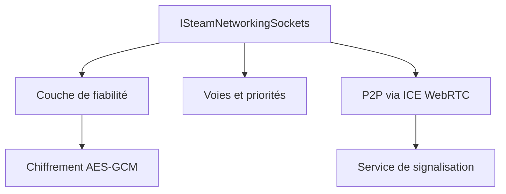

# ValveSoftware/GameNetworkingSockets

> Couche de transport réseau pour jeux : connexions par messages, fiables ou non, chiffrées, pair-à-pair possible.

## Le problème
TCP gêne les jeux (flux d'octets, blocage de tête de file) et UDP brut oblige à tout réécrire (fiabilité, chiffrement, fragmentation).

## Ce que ça fait vraiment
API orientée connexion mais orientée message, avec messages fiables et non fiables, fragmentation, retransmission, chiffrement AES-GCM-256 et échange de clés Curve25519. Gère des voies à priorité, la simulation de latence et de perte, IPv6 et le pair-à-pair via ICE de WebRTC.

## Comment c'est branché
Schéma simplifié d'après la fiche, sans diagramme fourni.

## Essayer
Aucune commande dans le README : voir le fichier BUILDING pour compiler, et les exemples example_chat.cpp et test_p2p.cpp.

## Coût et pièges
Gratuit, licence BSD-3-Clause. Certaines fonctions (authentification, signalisation, relais SDR) n'existent que sur Steam. Le dépôt contient du code hérité au style ancien.

## Ce que ce n'est pas
Pas une bibliothèque de synchronisation d'état de jeu : ni sérialisation d'entités, ni compression. Le nom « Steam » ne signifie pas que Steam soit requis.

## Alternatives
Aucune alternative nommée dans le README.

## Pour toi
À ignorer : réseau de jeux en C++, sans rapport avec un travail data, IA ou MLOps.

