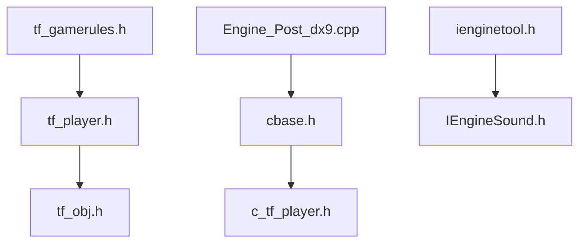

# ValveSoftware/source-sdk-2013

> Game source code of Half-Life 2, HL2: DM and Team Fortress 2, for mod creators.

## The problem
Creating a mod on the Source engine requires the starting game code and a build chain.

## What it actually does
Provides the shared game code, server and client, of HL2, HL2: DM and TF2. You generate projects (Visual Studio on Windows, container build on Linux) and compile your mod. The code also includes bot behaviors and interfaces with the engine.

## How it is wired



## Trying it
```bash
git clone https://github.com/ValveSoftware/source-sdk-2013
cd src
./buildallprojects
```
On Windows: `createallprojects.bat` in `src`, then build `everything.sln`.

## Cost and gotchas
Free, but you need Source SDK 2013 Multiplayer installed via Steam. Windows: Visual Studio 2022 and Python 3.13; Linux: podman. The license is not identified by GitHub.

## What it is not
Not a standalone engine: it attaches to a Steam installation. Mods distributed on Steam must be built against the Steam Runtime.

## Alternatives
No alternative named in the README.

## For you
Ignore: game mod development, unrelated to data, AI or MLOps work.
