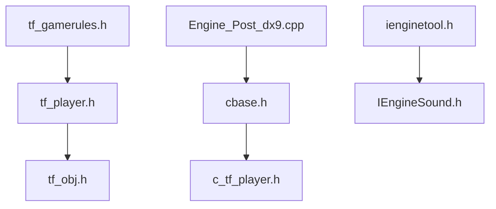

# ValveSoftware/source-sdk-2013

> Code source du jeu de Half-Life 2, HL2: DM et Team Fortress 2, pour créateurs de mods.

## Le problème
Créer un mod sur le moteur Source demande d'avoir le code de jeu de départ et une chaîne de build.

## Ce que ça fait vraiment
Fournit le code de jeu partagé, serveur et client de HL2, HL2: DM et TF2. On génère des projets (Visual Studio sous Windows, build par conteneur sous Linux) et on compile son mod. Le code inclut aussi des comportements de bots et des interfaces avec le moteur.

## Comment c'est branché



## Essayer
```bash
git clone https://github.com/ValveSoftware/source-sdk-2013
cd src
./buildallprojects
```
Sous Windows : `createallprojects.bat` dans `src`, puis build de `everything.sln`.

## Coût et pièges
Gratuit, mais il faut Source SDK 2013 Multiplayer installé via Steam. Windows : Visual Studio 2022 et Python 3.13 ; Linux : podman. La licence n'est pas identifiée par GitHub.

## Ce que ce n'est pas
Pas un moteur autonome : il se greffe sur une installation Steam. Les mods distribués sur Steam doivent être construits contre le Steam Runtime.

## Alternatives
Aucune alternative nommée dans le README.

## Pour toi
À ignorer : développement de mods de jeux, sans lien avec le travail data, IA ou MLOps.

