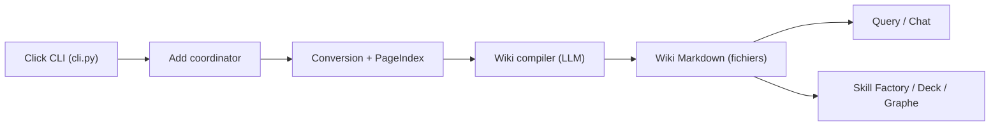

# VectifyAI/OpenKB

> CLI that compiles documents into an interlinked Markdown wiki using an LLM, with vectorless retrieval.

## The problem
Classic RAG rediscovers knowledge on every query and nothing accumulates across documents.

## What it actually does
`openkb add` converts files, folders or URLs to Markdown (markitdown), indexes long PDFs (≥ 20 pages) with PageIndex as a tree, then an LLM agent writes summaries, concept and entity pages, cross-links, an index and a log. You then query with `query` or `chat`. The generators produce agent skills, HTML decks and a graph. Optional web interface and FastAPI API. Storage is a file system, no database.

## How it is wired


## Trying it
```bash
pip install openkb
mkdir my-kb && cd my-kb
openkb init
openkb add paper.pdf
openkb query "What are the main findings?"
```

## Cost and gotchas
LLM key (`LLM_API_KEY`) via LiteLLM; each document triggers many calls (one document can touch 10 to 15 pages). The PageIndex cloud is optional. Without a token, the web API is not authenticated.

## What it is not
Not a vector RAG: no embeddings. `recompile` overwrites manual edits to pages.

## Alternatives
- PageIndex: the retrieval framework it builds on.

## For you
Worth watching: interesting for building a knowledge base that agents can query, but the cost in LLM calls at ingestion should be measured on a small corpus first.
