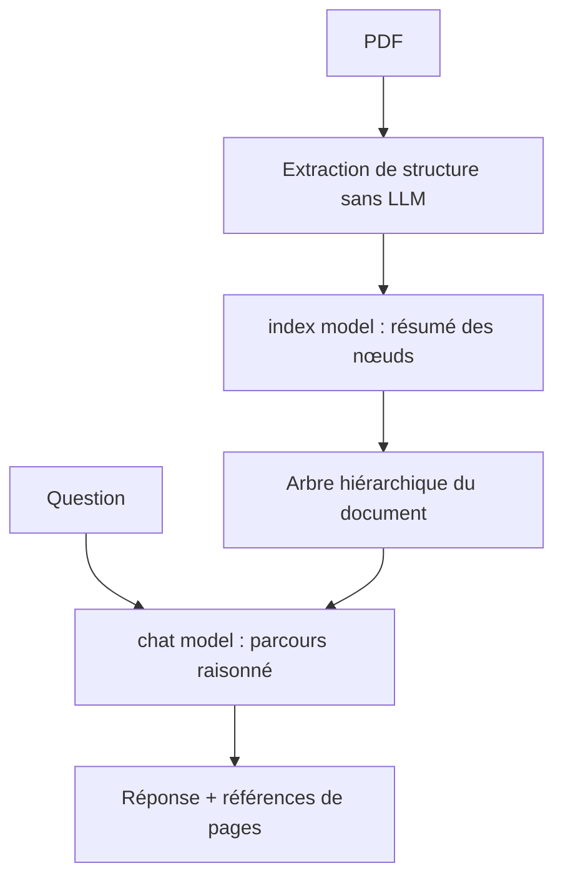

# VectifyAI/PageIndex

> Vectorless RAG engine: a tree index of a document, traversed by LLM reasoning.

## The problem
Vector search returns what looks like the question, not what answers it.
On an 800-page report, similarity and relevance diverge, and the document no longer fits in context.

## What it actually does
Two steps: generate a tree index per document, then search that tree through LLM reasoning, like an expert opening the right section.
No vector database, no chunking; answers are traceable to explicit references.
Local mode (indexing and search on your machine, your LLM key) or Cloud mode (parsing, OCR, image understanding, storage managed).
The SDK exposes `submit_document` and `chat`, and integrates as a tool in the OpenAI Agents SDK or the Claude Agent SDK.

## How it is wired


## Trying it
```bash
pip install -U pageindex
```

```python
from pageindex import PageIndexClient
client = PageIndexClient(index="gpt-5.6-luna", chat="gpt-5.6-sol")
doc_id = client.submit_document("report.pdf")["doc_id"]
print(client.chat("What was the 2023 operating margin?", doc_id=doc_id))
```

## Cost and gotchas
LLM key at your expense: the README claims ~$0.001 per page for local indexing, and the chat model consumes on every question.
OCR, images, block-level citations, metadata, folders and MCP server are reserved to Cloud, with a PageIndex key.

## What it is not
It is not free to use: it is open source that leads to a paid Cloud offer for everything beyond text PDFs.
It is not suited to scanned or image-heavy documents in local mode.
The announced benchmarks (98.7% on FinanceBench, 62 questions over 34 PDFs) come from the project itself.

## Alternatives
No competing repository is named in the README; it compares itself to "Vector RAG" in general.

## For you
Worth testing seriously if you do RAG on long, structured documents: the approach deserves a measurement on your corpus.
