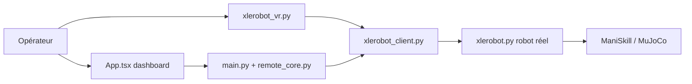

# Vector-Wangel/XLeRobot

> Mobile robot with an arm for embodied AI, to build yourself from 660 dollars.

## The problem
Embodied robotics platforms are expensive; there is no open, affordable robot for experimenting with embodied AI.

## What it actually does
A hardware and software project: bill of materials, 3D printing, assembly, then code to drive the real robot (two-wheel or mecanum version), VR and Joy-Con controller teleoperation, ManiSkill and MuJoCo simulation, a remote-control web dashboard with video stream and data recording. Built on LeRobot and SO-100/SO-101.

## How it is wired


## Trying it
```bash
# le README ne documente pas de commande : suivre les étapes
# 1. Bill of Materials  2. 3D printing  3. Assemble  4. Software
```

## Cost and gotchas
About $660 for the base version (excluding 3D printing, tools, shipping, taxes), plus camera and Raspberry Pi options. The README assumes basic Python, Ubuntu and Git skills, and disclaims all liability for damage caused.

## What it is not
Not standalone installable software: without the hardware, you can only simulate. The installations are described in external documentation, not read here.

## Alternatives
LeRobot, SO-100/SO-101, Lekiwi and Bambot: upstream projects, the basis of this repo.

## For you
Keep an eye on it: an affordable entry point to robotics and sim2real, useful if you want to apply RL or VLA to a real robot.
