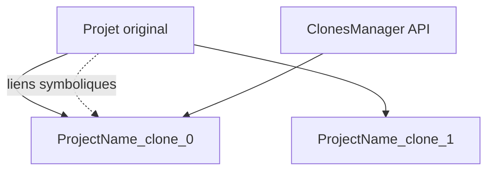

# VeriorPies/ParrelSync

> Unity editor extension that clones the project to test multiplayer without building.

## The problem
Testing a multiplayer game forces you to build after every change or to open several projects by hand.

## What it actually does
It copies the project folder and links `Assets`, `Packages` and `ProjectSettings` through symbolic links. The `Library`, `Temp` and `obj` folders stay specific to each clone. An API (`ClonesManager.IsClone()`) tells the original editor apart from the clone.

## How it is wired

Simplified diagram based on the sheet, no diagram provided.

## Trying it
```bash
# Package Unity (Packages/manifest.json) :
# "com.veriorpies.parrelsync": "https://github.com/VeriorPies/ParrelSync.git?path=/ParrelSync"
```

## Cost and gotchas
Free. Back up the project before installing. Requires Unity (2019.3.4 or later for UPM installation). Clones take up disk space and symbolic links.

## What it is not
Not a networking tool: it does not provide multiplayer, only editor clones to test it.

## Alternatives
- UnityProjectCloner (hwaet): the project ParrelSync was derived from.

## For you
Ignore: Unity tool for multiplayer games, unrelated to a data / AI / MLOps profile.
