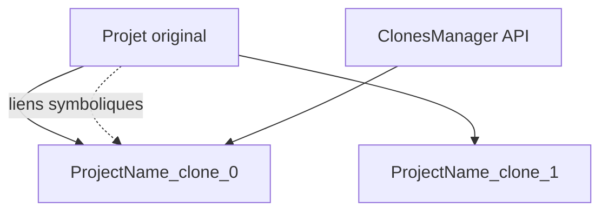

# VeriorPies/ParrelSync

> Extension de l'éditeur Unity qui clone le projet pour tester le multijoueur sans compiler.

## Le problème
Tester un jeu multijoueur oblige à compiler à chaque changement ou à ouvrir plusieurs projets à la main.

## Ce que ça fait vraiment
Elle copie le dossier du projet et relie `Assets`, `Packages` et `ProjectSettings` par liens symboliques. Les dossiers `Library`, `Temp` et `obj` restent propres à chaque clone. Une API (`ClonesManager.IsClone()`) distingue l'éditeur d'origine du clone.

## Comment c'est branché

Schéma simplifié d'après la fiche, sans diagramme fourni.

## Essayer
```bash
# Package Unity (Packages/manifest.json) :
# "com.veriorpies.parrelsync": "https://github.com/VeriorPies/ParrelSync.git?path=/ParrelSync"
```

## Coût et pièges
Gratuit. Sauvegarder le projet avant l'installation. Il faut Unity (2019.3.4 ou plus pour l'installation par UPM). Les clones occupent de la place disque et des liens symboliques.

## Ce que ce n'est pas
Ce n'est pas un outil réseau : il ne fournit pas le multijoueur, seulement des clones d'éditeur pour le tester.

## Alternatives
- UnityProjectCloner (hwaet) : le projet dont ParrelSync est issu.

## Pour toi
À ignorer : outil Unity pour le jeu multijoueur, sans rapport avec un profil data / IA / MLOps.

