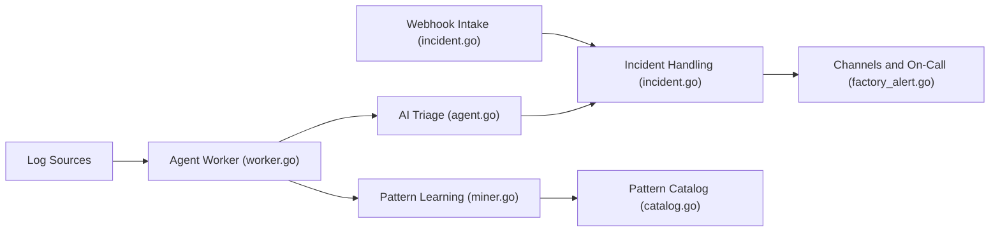

# VersusControl/versus-incident

> Self-hosted SRE agent that learns your logs and only escalates new anomalies, with notifications and on-call.

## The problem
Maintaining alert rules wears teams out; you want to be notified only of a new or unexpected error.

## What it actually does
Go service with a dashboard. Two incident sources: webhook alerts (Alertmanager, Grafana, Sentry, CloudWatch SNS…) or the SRE agent that reads logs (file, Elasticsearch), learns patterns and goes through three modes (`training`, `shadow`, `detect`). Incidents are formatted with Go templates, broadcast (Slack, Teams, Telegram, Viber, e-mail, Lark) and escalated (PagerDuty, AWS Incident Manager). Redis remembers the position in each source.

## How it is wired


## Trying it
```bash
docker run -d --name versus-redis -p 6379:6379 redis:7
docker run -p 3000:3000 -e GATEWAY_SECRET=change-me -e AGENT_ENABLE=true -e AGENT_MODE=training -e REDIS_HOST=host.docker.internal -e REDIS_PORT=6379 -v $(pwd)/config:/app/config -v $(pwd)/data:/app/data ghcr.io/versuscontrol/versus-incident
```

## Cost and gotchas
Free under MIT; an "Enterprise Pricing" offer exists (content not detailed). Redis is required for the agent and on-call. The README does not name the model used for triage (undocumented). File storage is the only implemented backend.

## What it is not
Not a metrics monitoring tool; it works on logs and webhooks. The `detect` mode is enabled after a learning phase that needs watching.

## Alternatives
No alternative named in the README.

## For you
Worth watching: the idea of a `shadow` mode before alerting makes sense for an MLOps profile that wants log triage, but the LLM provider is not specified in the README.
