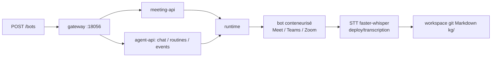

# Vexa-ai/vexa

> Open-source meeting bots and real-time transcription, self-hostable, for teams that care about their data.

## The problem
AI meeting tools send conversations to their cloud and resell you access.
"Chat with your documents" tools start after the transcription: nobody produces it.

## What it actually does
A bot joins Google Meet, Teams and Zoom (Jitsi validated offline) and streams live
transcripts attributed by speaker. Meetings are compiled into Markdown in a git repository
(an Open Knowledge Format `kg/` bundle) that coding agents read and write like a codebase.
The runtime launches each bot and each agent in its own isolated, ephemeral container, with no egress outside
brokered tools: `docker`, `process` or `k8s` backends (one Pod per dispatch, Helm chart provided).
Four agent triggers: chat, cron, event, end of meeting. Untrusted inputs run
in "propose-only" mode: the agent suggests, a human approves.

## How it is wired


## Trying it
```bash
git clone https://github.com/Vexa-ai/vexa.git && cd vexa
make all
make lite
make probe
curl -X POST "$API_BASE/bots" -H "X-API-Key: $API_KEY" -H "Content-Type: application/json" -d '{"platform":"google_meet","native_meeting_id":"abc-defg-hij","bot_name":"Vexa"}'
```

## Cost and gotchas
Apache-2.0. The hosted service gives $2 of credit, then $0.30/h of bot. Self-hosted, 
transcription is a separate GPU unit: without STT, `POST /bots` returns 503 (unless explicitly opted out).
`make dev` requires 8 vCPUs and 16 GB. One compliance point: in multi-user setups, other
users' turns must go through an API key, never through a personal subscription.

## What it is not
Not yet complete: `PUT /bots/{…}/config`, `POST /bots/{…}/speak`, WebSocket streaming
and `POST /agent/meeting/{start,process}` return 404 in the open core in 0.12.
Not a model: Vexa runs no LLM during the meeting, that is your agent.
Not a document RAG tool — it produces the material those tools consume.

## Alternatives
Recall.ai, a hosted API but in their cloud; Attendee, the other bot API, under the Elastic License 2.0
which forbids offering it as a managed service; DIY Whisper + a home-made bot.

## For you
The serious candidate if you need meeting notes without a third-party cloud: start with transcription alone.
