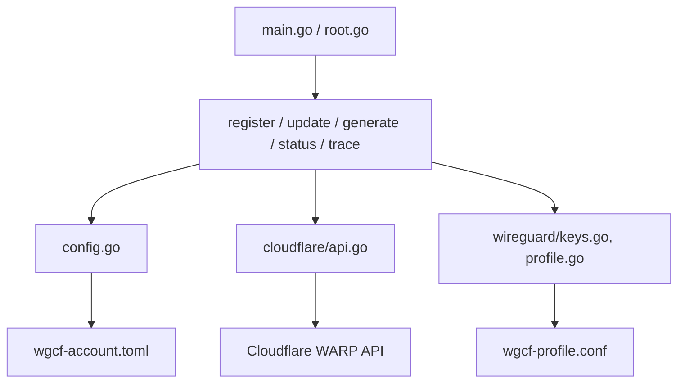

# ViRb3/wgcf

> Unofficial Go CLI that registers a Cloudflare Warp account and produces a WireGuard profile.

## The problem
Using Warp with a standard WireGuard client requires credentials that only the official application knows how to obtain.

## What it actually does
- `register` creates a Warp account and saves it in `wgcf-account.toml`.
- `generate` writes `wgcf-profile.conf` (MTU 1280 by default, optional keepalive).
- `update` changes the license key (Warp+ subscription), `status` shows the account state, `trace` checks for `warp=on` or `warp=plus`.
- The API client is generated from `openapi-spec.yml`.

## How it is wired


## Trying it
```bash
wgcf register
wgcf generate
wgcf generate --keepalive=60
wgcf status
wgcf trace
```

## Cost and gotchas
Free; depends on the Cloudflare API and its terms of use. A known bug can display `warp=on` despite a Warp+ key.

## What it is not
Not a Cloudflare product: the README states there is no affiliation. It is not a turnkey VPN, only a configuration generator; behavior may break if the API changes.

## Alternatives
- Official Cloudflare Warp client: supported, but without an exportable WireGuard profile.

## For you
Watch: handy for outbound WireGuard access, with no direct relation to a data/AI flow, and dependent on a third-party service that is not guaranteed.
