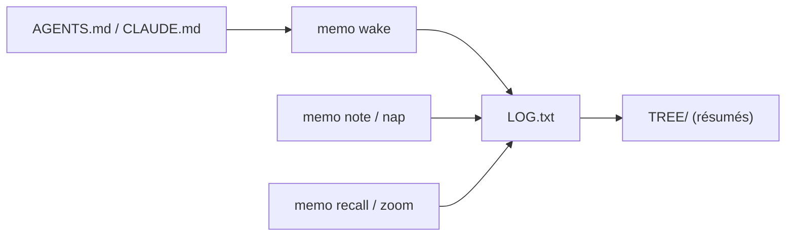

# VictorTaelin/OptMem

> Permanent memory for agents: a 426-token prompt and a dependency-free Python script.

## The problem
An agent forgets everything from one session to the next, or drowns its context in notes.

## What it actually does
The `memo` script writes each memory on one line (280 bytes max) in an append-only log, then builds a binary tree of summaries that the agent compresses as it goes with `note`. `wake` reads the memory at startup, `recall` searches by regex, `zoom` opens a node. Nothing runs in the background. A `## Memory` block to paste into `AGENTS.md` or `CLAUDE.md` completes the integration.

## How it is wired


## Trying it
```bash
curl -fsSL https://raw.githubusercontent.com/VictorTaelin/OptMem/main/install.sh | sh
memo wake
memo note "..."
```

## Cost and gotchas
Free, but the summaries are written by your agent, so with your model's tokens. `curl | sh`: read the script first. Repository created on 2026-07-25.

## What it is not
No declared license: reuse rights are unclear. The performance figures (one million memories, 0.03 s) are the README's.

## Alternatives
No alternative named in the README.

## For you
Worth watching: a simple, readable idea of agent memory, but unlicensed and very young.
