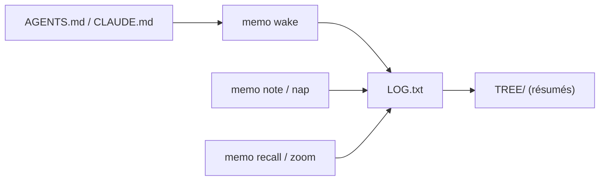

# VictorTaelin/OptMem

> Mémoire permanente pour agents : un prompt de 426 tokens et un script Python sans dépendance.

## Le problème
Un agent oublie tout d'une session à l'autre, ou noie son contexte de notes.

## Ce que ça fait vraiment
Le script `memo` écrit chaque souvenir sur une ligne (280 octets max) dans un journal en ajout seul, puis construit un arbre binaire de résumés que l'agent compresse au fil des `note`. `wake` lit la mémoire au démarrage, `recall` cherche par regex, `zoom` ouvre un nœud. Rien ne tourne en arrière-plan. Un bloc `## Memory` à coller dans `AGENTS.md` ou `CLAUDE.md` complète l'intégration.

## Comment c'est branché


## Essayer
```bash
curl -fsSL https://raw.githubusercontent.com/VictorTaelin/OptMem/main/install.sh | sh
memo wake
memo note "..."
```

## Coût et pièges
Gratuit, mais les résumés sont rédigés par ton agent, donc avec les tokens de ton modèle. `curl | sh` : relire le script avant. Dépôt créé le 2026-07-25.

## Ce que ce n'est pas
Pas de licence déclarée : droits de réutilisation flous. Les chiffres de performance (un million de souvenirs, 0,03 s) sont ceux du README.

## Alternatives
Aucune alternative nommée dans le README.

## Pour toi
À surveiller : idée simple et lisible de mémoire d'agent, mais sans licence et très jeune.

