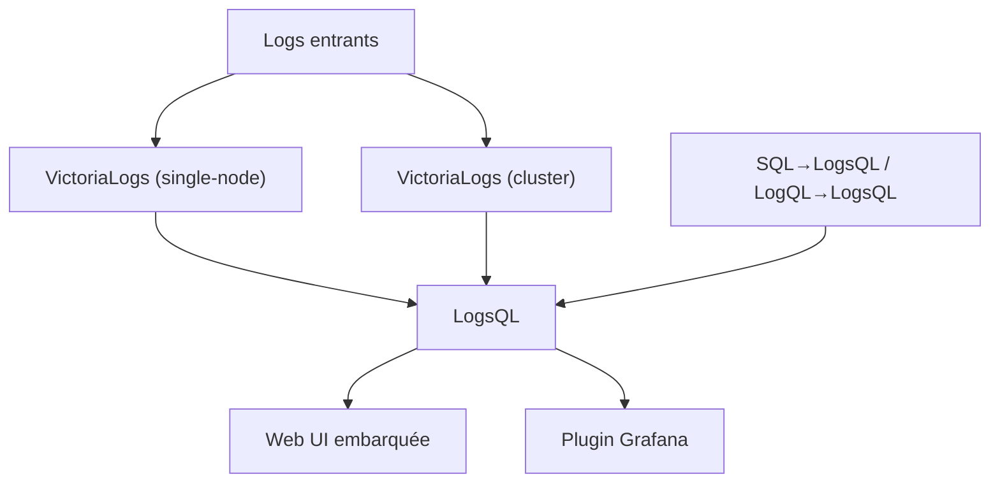

# VictoriaMetrics/VictoriaLogs

> Schemaless, zero-configuration log database, from small setups to a terabyte per day.

## The problem
Storing and querying logs at scale usually requires a schema, index tuning and a bill that
grows with volume.

## What it actually does
The README is very short. It announces a performant, lightweight log database with no
configuration and no schema, scaling vertically and horizontally. Two deployment forms exist,
single node and cluster version, both open source and free. A homegrown query language,
LogsQL, is implied by the presence of "SQL to LogsQL" and "LogQL to LogsQL" converters in the
playgrounds. A web UI is embedded and a Grafana plugin is provided.

## How it is wired

## Trying it
No command is documented in this README: it lists links (release binaries, Docker images on
Docker Hub and Quay, source code, documentation, CHANGELOG, upgrade guide).

## Cost and gotchas
Free in both variants. The README says nothing about required resources, retention, or a
possible commercial offering; VictoriaMetrics is a company, so check this before committing.

## What it is not
Not VictoriaMetrics (metrics): it is the logs product from the same company. Not a complete
observability stack: no collection agent described here, no alerting mentioned. The README is
not enough to judge: insufficient material.

## Alternatives
- The README names no alternative; it only mentions LogQL (Loki) and SQL as source languages
  for conversion.

## For you
Worth testing if your Loki or Elastic bill hurts; to be confirmed on the documentation, not on this README.
