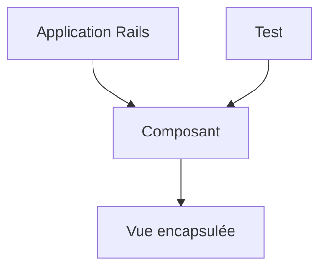

# ViewComponent/view_component

> Framework for building reusable, testable, encapsulated view components in Ruby on Rails.

## The problem
Classic Rails views become hard to reuse and to test in isolation.

## What it actually does
The README only says: a framework of reusable, testable, encapsulated view components for Rails. The rest is on viewcomponent.org, not read here.

## How it is wired
Simplified diagram based on the sheet, no diagram provided.

## Trying it
No command documented in the README.

## Cost and gotchas
Free. Real requirement: Ruby and Rails. Installation not documented in the README.

## What it is not
Not a front-end framework independent of Rails. Minimal sheet: the README is very short.

## Alternatives
No alternative named in the README.

## For you
Ignore: Rails-specific framework, unrelated to your data / AI pipelines.
