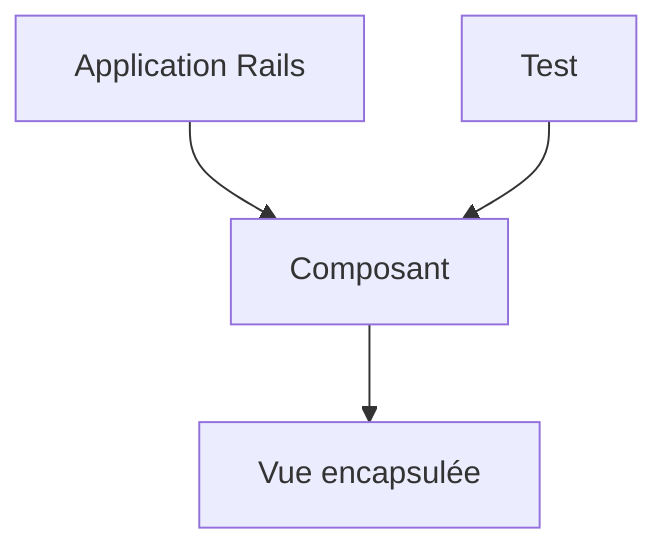

# ViewComponent/view_component

> Cadre pour construire des composants de vue réutilisables, testables et encapsulés dans Ruby on Rails.

## Le problème
Les vues Rails classiques deviennent difficiles à réutiliser et à tester isolément.

## Ce que ça fait vraiment
Le README ne dit que : cadre de composants de vue réutilisables, testables et encapsulés pour Rails. Le reste est sur viewcomponent.org, non lu ici.

## Comment c'est branché
Schéma simplifié d'après la fiche, sans diagramme fourni.

## Essayer
Aucune commande documentée dans le README.

## Coût et pièges
Gratuit. Besoin réel : Ruby et Rails. Installation non documentée dans le README.

## Ce que ce n'est pas
Pas un cadre front-end indépendant de Rails. Fiche minimale : le README est très court.

## Alternatives
Aucune alternative nommée dans le README.

## Pour toi
À ignorer : cadre spécifique à Rails, sans lien avec tes chaînes data / IA.

