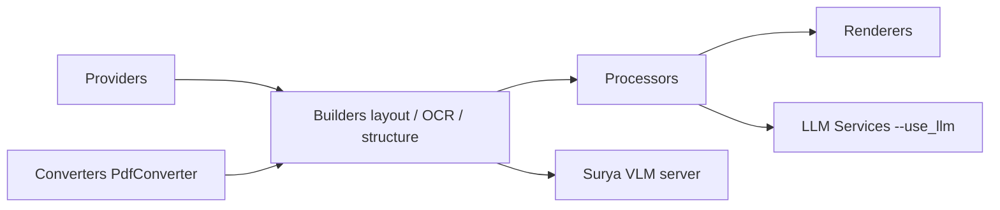

# VikParuchuri/marker

> Converts PDF, images, Office, HTML and EPUB into Markdown, JSON, HTML or chunks, for document pipelines.

## The problem
Cleanly extracting text, tables, formulas and images from a PDF for a RAG or analysis pipeline is fragile.

## What it actually does
Marker reads the PDF text, detects the layout, decides page by page whether the text is usable, and hands damaged or scanned pages, equations and some tables to a vision model (surya) served locally (vLLM in Docker on an NVIDIA GPU, llama.cpp elsewhere). Two modes: `balanced` (GPU) and `fast` (CPU). The `--use_llm` option adds an external LLM. Outputs: Markdown, JSON, HTML, chunks.

## How it is wired


## Trying it
```bash
pip install marker-pdf
pip install marker-pdf[full]
marker_single /path/to/file.pdf
marker /path/to/input/folder
marker_server --port 8001
```

## Cost and gotchas
Code under Apache 2.0; model weights under a modified Open Rail-M license, free for research, personal use and startups under $5M, paid beyond that. `--use_llm` sends documents to a third-party provider (Gemini by default) with a key at your expense. The benchmark figures come from the author.

## What it is not
Not a state-of-the-art full-page OCR: for scans and math, the README points to Chandra or surya. The built-in server API is not robust.

## Alternatives
- MinerU: cited, slower than Marker balanced but close in quality (pipeline).
- docling: cited, lower score in the author's benchmark.
- Chandra: hosted model from Datalab, more accurate.

## For you
Adopt it to turn PDF corpora into Markdown or chunks before indexing, checking the weights' license if the use is commercial.
