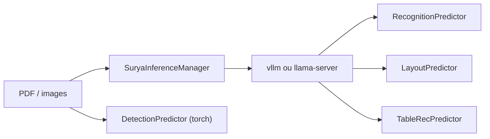

# VikParuchuri/surya

> 650M-parameter OCR model with layout and table analysis, for extracting text from documents.

Note: this repo carries the same README as `datalab-to/surya` (same creation date, same issues); it is presumably the former name of the same project.

## The problem
Extracting text, layout, reading order, tables and formulas from PDFs and images in many languages, without a giant model.

## What it actually does
Surya 2 does layout, OCR (full page or per block) and table recognition with a single vision-language model. It runs behind a `vllm` server (NVIDIA GPU, via Docker) or `llama.cpp` (CPU, Apple Silicon), started automatically. A small separate torch model handles line detection. Outputs are JSON with `blocks`, `html`, `bbox`, `confidence`. The README claims 83.3% on olmOCR-bench and 5.35 pages/s on an RTX 5090 (the author's measurements).

## How it is wired


## Trying it
```bash
pip install surya-ocr
surya_ocr DATA_PATH
surya_layout DATA_PATH
surya_table DATA_PATH
surya_detect DATA_PATH
surya_gui
```

## Cost and gotchas
Free for the code (Apache 2.0). The weights follow a modified AI Pubs Open Rail-M license: free for research, personal use and startups under $5M; beyond that, a paid license. Docker and NVIDIA Container Toolkit required on the GPU side; `llama.cpp` otherwise (0.108 page/s measured on Apple Silicon).

## What it is not
Not made for photos or natural scenes. Detection alone works without a server; the rest requires a running inference backend.

## Alternatives
Chandra OCR 2 (same publisher, more accurate), dots.mocr, LightOnOCR 2-1B, olmOCR and GOT OCR, cited in the README's table.

## For you
Adopt for document extraction: small model, good claimed scores; check the weights' license first if the use is commercial.
