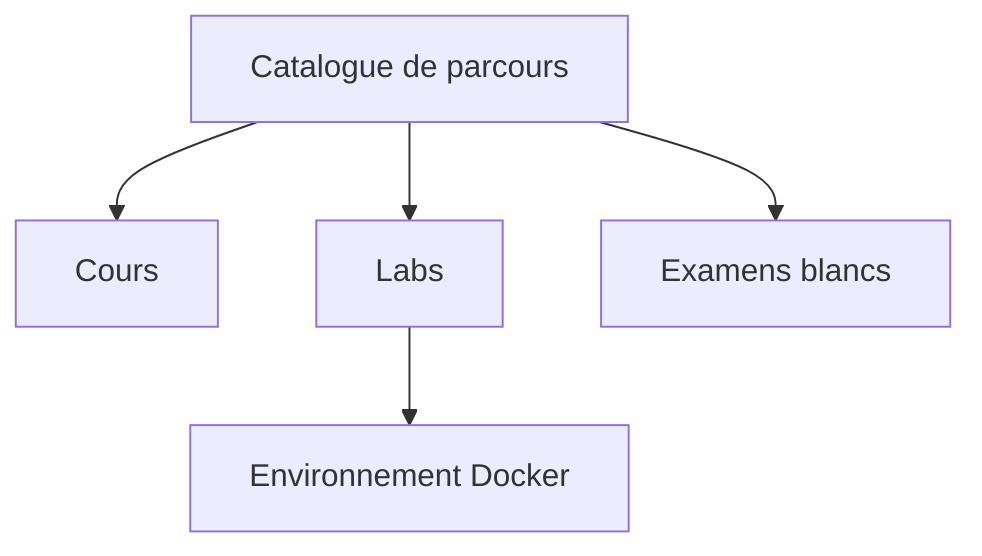

# ViktorUJ/cks

> Open platform of Kubernetes, security, Istio and EKS courses, labs and mock exams for SRE engineers.

## The problem
Paid courses age quickly and prepare poorly for the hands-on side of Kubernetes certifications.

## What it actually does
- Courses and labs for CKA, CKAD, CKS, Amazon EKS, Istio/ICA, KCSA.
- Mock exams for CKA, CKAD, CKS, ICA, KCSA, KCNA, LFCS and AWS AI Practitioner.
- Labs translated into eight languages, including French; the exams remain in their original language.
- A "Quick start with Docker" section exists, but the command is not reproduced in the README provided.

## How it is wired
Simplified diagram based on the sheet, no diagram provided.


## Trying it
```bash
# Aucune commande documentée dans le texte du README fourni.
```

## Cost and gotchas
Free. Running the EKS labs probably requires an AWS account: not documented here.

## What it is not
Not a software tool but a training resource. The mock exams do not replace the official certifications.

## Alternatives
No alternative named in the README.

## For you
Worth watching: useful if you are preparing CKA or CKS for MLOps infrastructure, of no direct interest for modeling.
