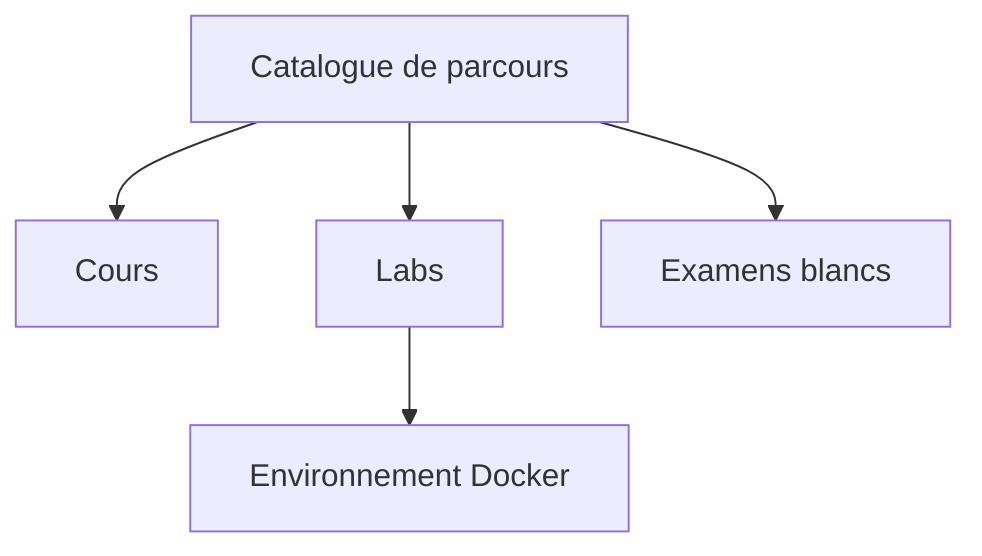

# ViktorUJ/cks

> Plateforme libre de cours, labs et examens blancs Kubernetes, sécurité, Istio et EKS pour ingénieurs SRE.

## Le problème
Les cours payants vieillissent vite et se préparent mal à la pratique des certifications Kubernetes.

## Ce que ça fait vraiment
- Cours et labs pour CKA, CKAD, CKS, Amazon EKS, Istio/ICA, KCSA.
- Examens blancs pour CKA, CKAD, CKS, ICA, KCSA, KCNA, LFCS et AWS AI Practitioner.
- Labs traduits en huit langues, dont le français ; les examens restent dans leur langue d'origine.
- Une section « Quick start with Docker » existe, mais la commande n'est pas reprise dans le README fourni.

## Comment c'est branché
Schéma simplifié d'après la fiche, sans diagramme fourni.


## Essayer
```bash
# Aucune commande documentée dans le texte du README fourni.
```

## Coût et pièges
Gratuit. L'exécution des labs EKS suppose probablement un compte AWS : non documenté ici.

## Ce que ce n'est pas
Pas un outil logiciel mais un support de formation. Les examens blancs ne remplacent pas les certifications officielles.

## Alternatives
Aucune alternative nommée dans le README.

## Pour toi
À surveiller : utile si tu prépares CKA ou CKS pour l'infrastructure MLOps, sans intérêt direct pour la modélisation.

