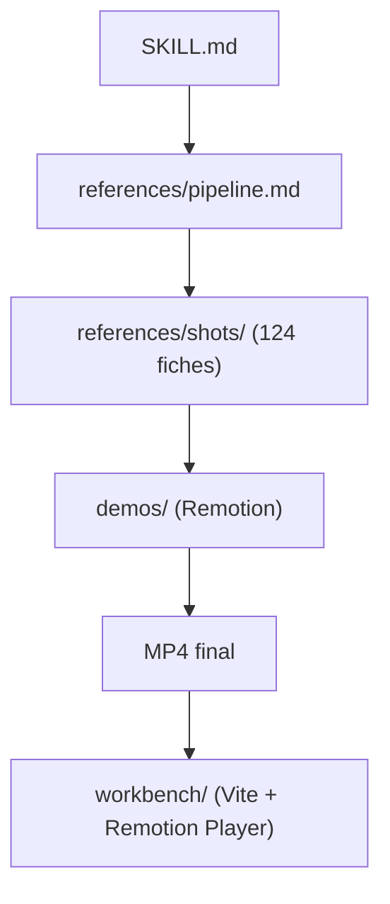

# Vincentwei1021/video-shotcraft

> Skill for Claude Code or Codex that produces a promo video as an MP4 from your screenshots.

## The problem
Producing a polished product video requires storyboarding, animating and mixing by hand.

## What it actually does
The agent captures your pages, picks shots from a library of 124 cards (150 shots, 10 categories), animates with Remotion, syncs to the beat, adds Freesound sound effects and checks the frames. Output: 1920×1080 MP4 at 30 fps and an editable Remotion project. Options: JianYing draft, "Motion Workbench" editor, publishing via Upload-Post.

## How it is wired


## Trying it
```bash
npx skills add Vincentwei1021/video-shotcraft
git clone https://github.com/Vincentwei1021/video-shotcraft.git
ln -s "$(pwd)" ~/.claude/skills/video-shotcraft
node workbench/scripts/open.mjs
```

## Cost and gotchas
Free, but the agent (Claude Code or Codex) is at your expense. Required: Node.js, ffmpeg, uv and puppeteer depending on the step. Tested on macOS; Linux needs tweaks (`--concurrency=1`, chrome-headless-shell).

## What it is not
Not an AI video generator: every frame is drawn by code from your screenshots. The screenshots shipped with the template are demos to be replaced.

## Alternatives
- video-talkcraft: variant by the same author for narrated videos.

## For you
Watch: nice for a product demo, outside data/AI/MLOps; recent project (created in July 2026) by a single author.
