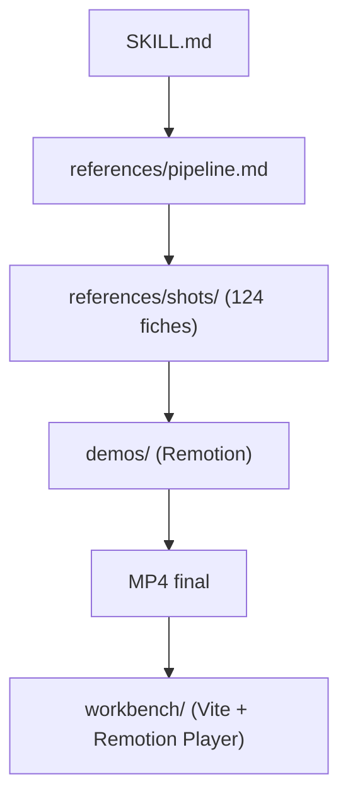

# Vincentwei1021/video-shotcraft

> Skill pour Claude Code ou Codex qui produit une vidéo promo en MP4 à partir de vos captures.

## Le problème
Monter une vidéo produit soignée demande de storyboarder, animer et mixer à la main.

## Ce que ça fait vraiment
L'agent capture vos pages, choisit des plans dans une bibliothèque de 124 fiches (150 plans, 10 catégories), anime avec Remotion, cale sur le rythme, ajoute des effets sonores Freesound et vérifie les images. Sortie : MP4 1920×1080 à 30 i/s et projet Remotion éditable. Option : brouillon JianYing, éditeur « Motion Workbench », publication via Upload-Post.

## Comment c'est branché


## Essayer
```bash
npx skills add Vincentwei1021/video-shotcraft
git clone https://github.com/Vincentwei1021/video-shotcraft.git
ln -s "$(pwd)" ~/.claude/skills/video-shotcraft
node workbench/scripts/open.mjs
```

## Coût et pièges
Gratuit, mais l'agent (Claude Code ou Codex) est à ta charge. Requis : Node.js, ffmpeg, uv et puppeteer selon l'étape. Testé sur macOS ; Linux demande des réglages (`--concurrency=1`, chrome-headless-shell).

## Ce que ce n'est pas
Pas un générateur de vidéo par IA : chaque image est dessinée par code à partir de vos captures. Les captures fournies avec le template sont des démos à remplacer.

## Alternatives
- video-talkcraft : variante du même auteur pour les vidéos narrées.

## Pour toi
Surveiller : sympa pour une démo produit, hors data/IA/MLOps ; projet récent (créé en juillet 2026) d'un auteur unique.

