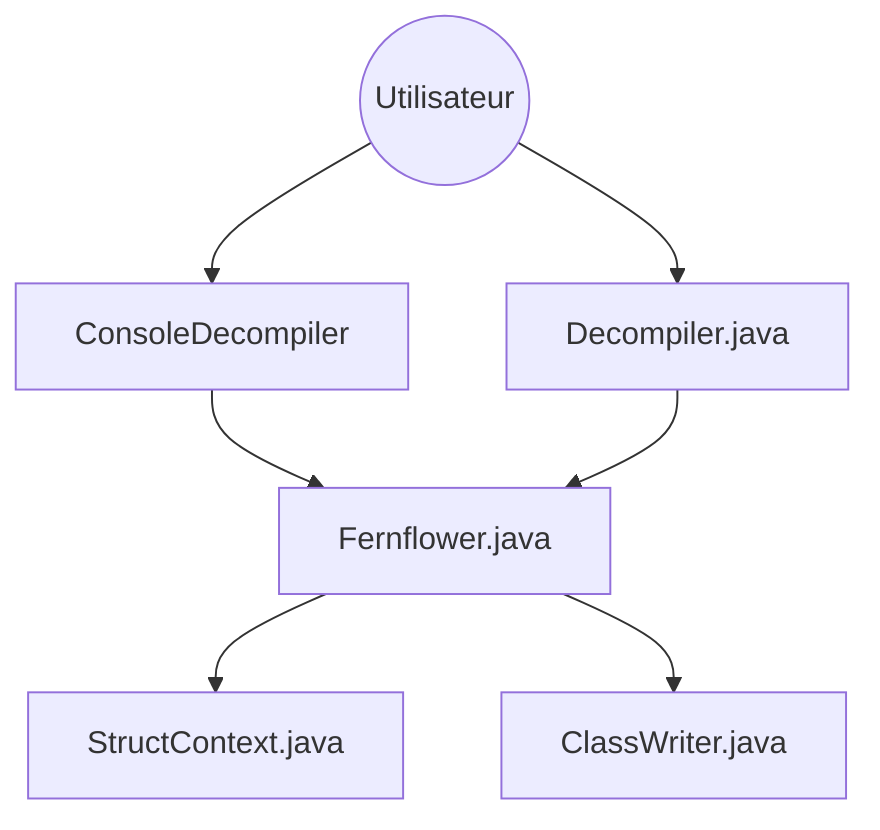

# Vineflower/vineflower

> Modern decompiler for Java and JVM languages, usable from the command line or as a library.

## The problem
Recovering readable source code from compiled classes, including recent ones.

## What it actually does
Accepts a jar, zip, folder or class file, rebuilds the control flow and expressions, then writes formatted Java. It handles Java 21 constructs (records, sealed classes, switch, patterns) and decompiles in parallel. Plugins exist for Kotlin, Scala and variable renaming. The code derives from Fernflower.

## How it is wired


## Trying it
```bash
java -jar vineflower.jar <entrée> <sortie>
./gradlew build
```

## Cost and gotchas
Free. Java 17 or later for versions 1.11 and up. No key or service needed. The output is a reconstruction, not the original source.

## What it is not
Not a circumvention or piracy tool: it is a decompiler. Not a bytecode fixer.

## Alternatives
No alternative named in the README (Fernflower is mentioned as the base, replaced in IntelliJ by the plugin).

## For you
Ignore: used to read JVM binaries, rare in a data/AI chain, except when reverse-engineering a third-party jar.
