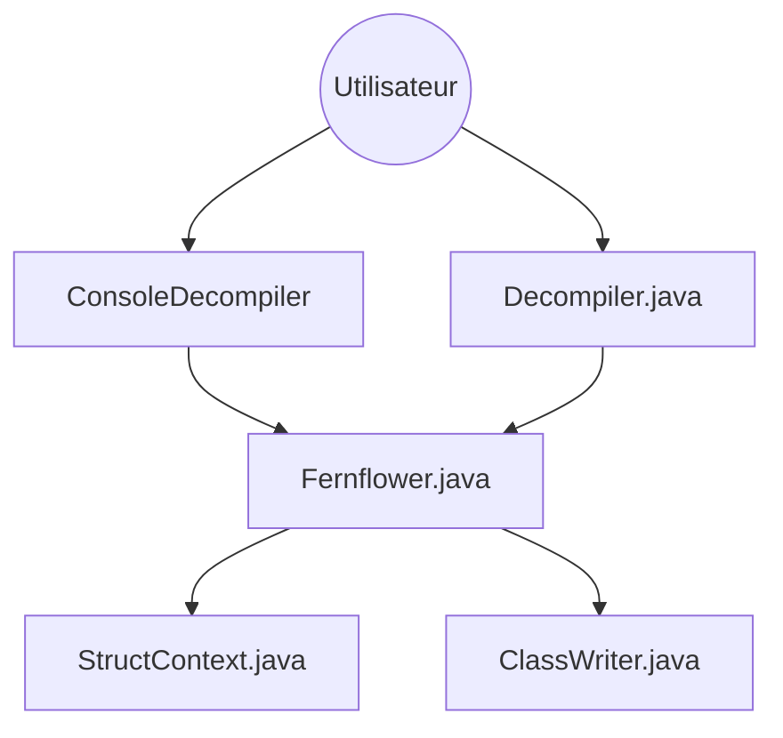

# Vineflower/vineflower

> Décompileur moderne pour Java et langages de la JVM, utilisable en ligne de commande ou en bibliothèque.

## Le problème
Retrouver du code source lisible à partir de classes compilées, y compris récentes.

## Ce que ça fait vraiment
Accepte un jar, zip, dossier ou fichier class, reconstruit le flot de contrôle et les expressions, puis écrit du Java formaté. Il gère les constructions Java 21 (records, classes scellées, switch, motifs) et décompile en parallèle. Des greffons existent pour Kotlin, Scala et le renommage de variables. Le code dérive de Fernflower.

## Comment c'est branché


## Essayer
```bash
java -jar vineflower.jar <entrée> <sortie>
./gradlew build
```

## Coût et pièges
Gratuit. Java 17 ou plus pour les versions 1.11 et suivantes. Aucune clé ni service. La sortie est une reconstruction, pas la source d'origine.

## Ce que ce n'est pas
Pas un outil de contournement ou de piratage : un décompileur. Pas un correcteur de bytecode.

## Alternatives
Aucune alternative nommée dans le README (Fernflower est évoqué comme base, remplacée dans IntelliJ par le greffon).

## Pour toi
À ignorer : sert à lire des binaires JVM, rare dans une chaîne data/IA, sauf en rétro-ingénierie d'un jar tiers.

