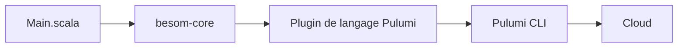

# VirtusLab/besom

> Scala SDK for writing Pulumi infrastructure-as-code programs, in public beta.

## The problem
Scala teams want to describe their cloud infrastructure in their own language rather than in YAML or another language.

## What it actually does
Lets you write Pulumi resources (AWS, Azure, Google Cloud, Kubernetes) in Scala 3, with Scala CLI, sbt, Maven or Gradle. It is not a wrapper around Pulumi's Java SDK: the implementation is separate. Resources are lazily evaluated.

## How it is wired


## Trying it
```bash
curl -fsSL https://get.pulumi.com/ | sh
curl -sSLf https://scala-cli.virtuslab.org/get | sh
pulumi plugin install language scala 0.5.0 --server github://api.github.com/VirtusLab/besom
pulumi new https://github.com/VirtusLab/besom/tree/v0.5.0/templates/aws
pulumi up
pulumi destroy -y
```

## Cost and gotchas
Cloud account and bill are on you. JDK 11+ and Scala 3.3.1+ are required (not listed in the prerequisites). No Mill support. Do not use `com.pulumi:*`.

## What it is not
Not Pulumi's Java SDK. The versions in the README (0.5.0) may lag behind the code.

## Alternatives
No alternative named in the README.

## For you
Worth watching: only interesting if your infrastructure is already in Scala; otherwise Pulumi in Python is enough for you without going through this SDK.
