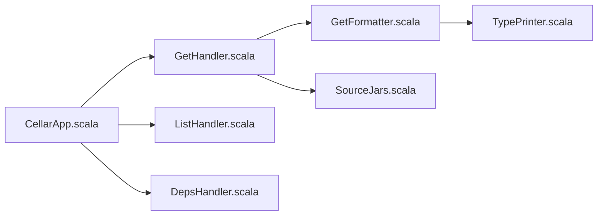

# VirtusLab/cellar

> CLI that returns the public API of any JVM dependency as Markdown, for coding agents and developers.

## The problem
An agent calling an unknown library method parses HTML, hunts for sources or invents the API.

## What it actually does
Queries a Maven coordinate or the project classpath (Mill, sbt, scala-cli) and displays signatures, members, docs and sources: `get`, `list`, `search`, `get-source`, `deps`, with `-external` variants. Markdown output on stdout, diagnostics on stderr. A Claude Code skill is provided, as well as a plugin.

## How it is wired


## Trying it
```sh
cs install --contrib cellar
cellar get-external org.typelevel:cats-core_3:2.10.0 cats.Monad
cellar search-external org.typelevel:cats-core_3:2.10.0 flatMap
```

## Cost and gotchas
Free. Resolution via Coursier; private repositories through Coursier credentials. A daily update check is active by default (skipped in CI).

## What it is not
Limited to JVM dependencies. Anonymous telemetry is opt-in: outside an interactive terminal, the command stays blocked until a choice is recorded (`cellar telemetry disable`).

## Alternatives
No alternative named in the README.

## For you
Adopt only if you work with Scala or Java alongside an agent: clear idea, MPL-2.0; otherwise irrelevant.
