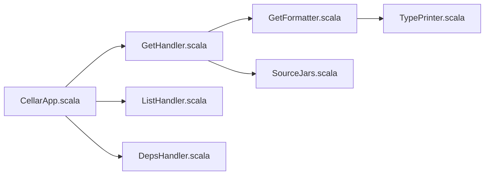

# VirtusLab/cellar

> CLI qui renvoie en Markdown l'API publique de toute dépendance JVM, pour agents de code et développeurs.

## Le problème
Un agent qui appelle une méthode de bibliothèque inconnue parse du HTML, cherche les sources ou invente l'API.

## Ce que ça fait vraiment
Interroge une coordonnée Maven ou le classpath du projet (Mill, sbt, scala-cli) et affiche signatures, membres, docs et sources : `get`, `list`, `search`, `get-source`, `deps`, avec variantes `-external`. Sortie Markdown sur stdout, diagnostics sur stderr. Un skill Claude Code est fourni, ainsi qu'un plugin.

## Comment c'est branché


## Essayer
```sh
cs install --contrib cellar
cellar get-external org.typelevel:cats-core_3:2.10.0 cats.Monad
cellar search-external org.typelevel:cats-core_3:2.10.0 flatMap
```

## Coût et pièges
Gratuit. Résolution via Coursier ; dépôts privés par identifiants Coursier. Une vérification de mise à jour quotidienne est active par défaut (ignorée en CI).

## Ce que ce n'est pas
Limité aux dépendances JVM. La télémétrie anonyme est optin : hors terminal interactif, la commande reste bloquée tant qu'un choix n'est pas enregistré (`cellar telemetry disable`).

## Alternatives
Aucune alternative nommée dans le README.

## Pour toi
Adopter seulement si tu touches du Scala ou du Java avec un agent : idée nette, MPL-2.0 ; sinon sans objet.

