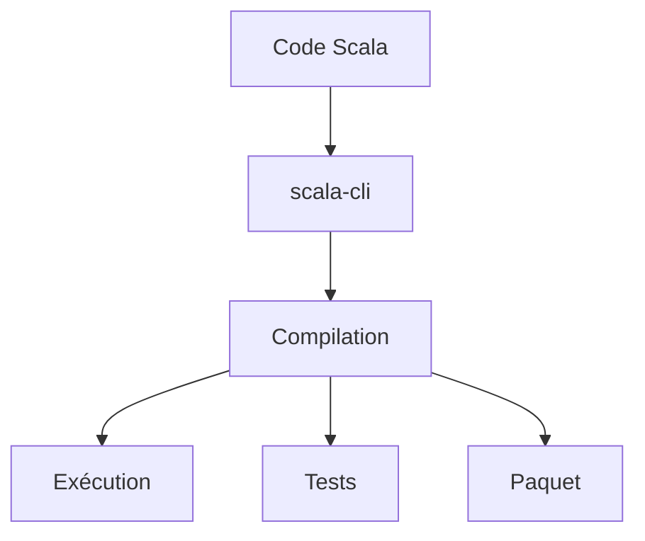

# VirtusLab/scala-cli

> Command-line tool to compile, run, test and package Scala, now the `scala` launcher.

## The problem
Running a small Scala program normally requires a build tool.

## What it actually does
The README is very short. It describes a tool that compiles, runs, tests and packages Scala, without multi-modules or extensible tasks. Since Scala 3.5.0, it is the official `scala` launcher. The rest is links to the documentation.

## How it is wired
Simplified diagram based on the sheet, no diagram provided.

## Trying it
No command in the README: refer to scala-cli.virtuslab.org.

## Cost and gotchas
Free. Installation is not documented in the README. 312 open issues.

## What it is not
Not a multi-module build tool like sbt.

## Alternatives
No alternative named in the README.

## For you
Ignore: Scala is useful for Spark, but the README shows no data usage, so no reason to dive in.
