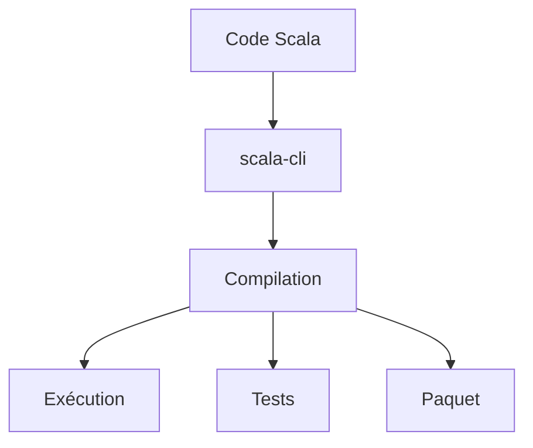

# VirtusLab/scala-cli

> Outil en ligne de commande pour compiler, exécuter, tester et empaqueter du Scala, désormais le lanceur `scala`.

## Le problème
Lancer un petit programme Scala demande normalement un outil de build.

## Ce que ça fait vraiment
Le README est très court. Il décrit un outil qui compile, exécute, teste et empaquette du Scala, sans multi-modules ni tâches extensibles. Depuis Scala 3.5.0, il est le lanceur officiel `scala`. Le reste est des liens vers la documentation.

## Comment c'est branché
Schéma simplifié d'après la fiche, sans diagramme fourni.

## Essayer
Aucune commande dans le README : se reporter à scala-cli.virtuslab.org.

## Coût et pièges
Gratuit. Installation non documentée dans le README. 312 issues ouvertes.

## Ce que ce n'est pas
Pas un outil de build multi-modules à la sbt.

## Alternatives
Aucune alternative nommée dans le README.

## Pour toi
À ignorer : Scala est utile pour Spark, mais le README ne montre aucun usage data, donc pas de raison de s'y plonger.

