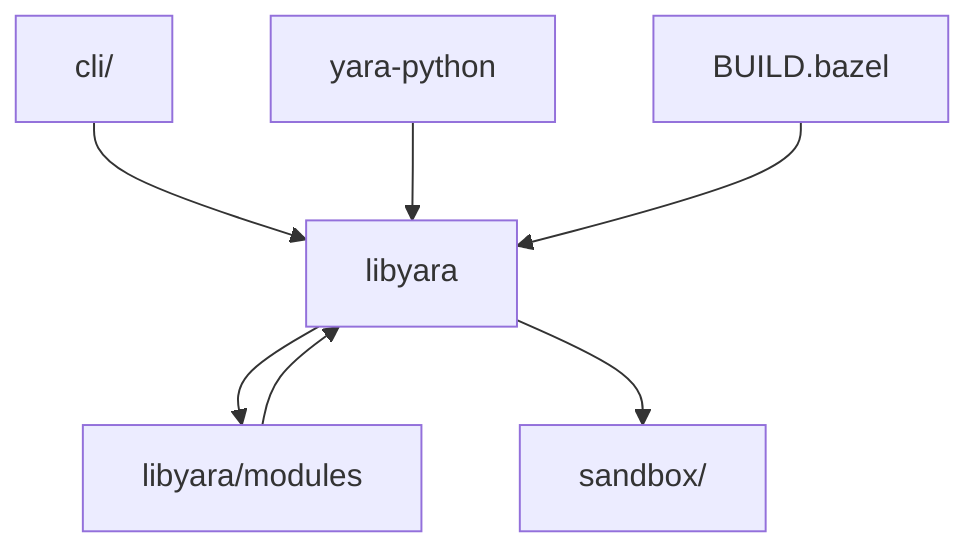

# VirusTotal/yara

> Rule engine to identify and classify malicious files by text or binary patterns.

## The problem
Describe a malware family as shareable signatures that can be tested against files.

## What it actually does
A rule combines strings (text, hexadecimal, regular expressions) and a boolean condition. YARA scans files with these rules, on the command line or via yara-python. Modules (PE, ELF, hash) extend the analysis.

## How it is wired

## Trying it
No command documented in the README; the example rule `silent_banker` is given there in YARA. The tool is used on the command line or from Python with yara-python.

## Cost and gotchas
Free, BSD-3-Clause license. The repository is in maintenance mode: the README points to the YARA-X announcement as the stable version.

## What it is not
Not an antivirus: it only detects what rules written elsewhere describe. It does not scan compressed archives without a third-party extension.

## Alternatives
- yextend: extension to scan compressed files.
- YARA-CI: continuous testing of rules on GitHub.

## For you
Worth watching: useful if you do suspicious file detection, but in maintenance; check YARA-X before committing.
