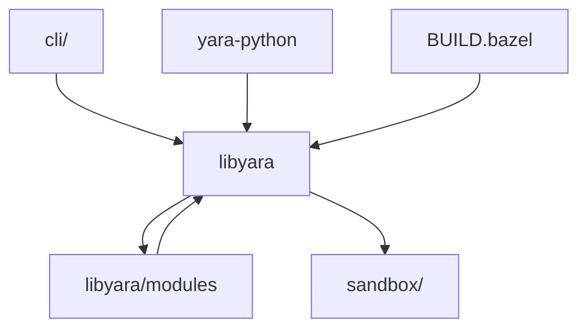

# VirusTotal/yara

> Moteur de règles pour identifier et classer des fichiers malveillants par motifs textuels ou binaires.

## Le problème
Décrire une famille de logiciels malveillants sous forme de signatures partageables et testables sur des fichiers.

## Ce que ça fait vraiment
Une règle combine des chaînes (texte, hexadécimal, expressions régulières) et une condition booléenne. YARA scanne des fichiers avec ces règles, en ligne de commande ou via yara-python. Des modules (PE, ELF, hash) étendent l'analyse.

## Comment c'est branché

## Essayer
Aucune commande documentée dans le README ; la règle d'exemple `silent_banker` y est donnée en YARA. L'outil s'utilise en ligne de commande ou depuis Python avec yara-python.

## Coût et pièges
Gratuit, licence BSD-3-Clause. Le dépôt est en mode maintenance : le README renvoie vers l'annonce de YARA-X comme version stable.

## Ce que ce n'est pas
Pas un antivirus : il ne détecte que ce que décrivent des règles écrites par ailleurs. Il ne scanne pas les archives compressées sans extension tierce.

## Alternatives
- yextend : extension pour scanner les fichiers compressés.
- YARA-CI : test continu de règles sur GitHub.

## Pour toi
À surveiller : utile si tu fais de la détection de fichiers suspects, mais en maintenance ; vérifie YARA-X avant de t'engager.

