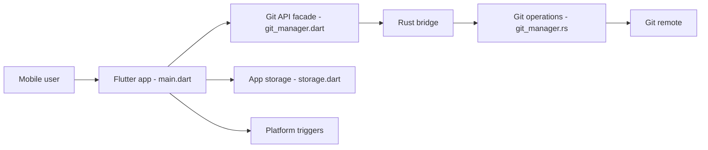

# ViscousPot/GitSync

> Android and iOS mobile git client that syncs a local folder with a remote repository in the background.

## The problem
Keeping a folder of notes or config in sync with a git repository from a phone requires manual steps and a terminal.

## What it actually does
Flutter application with a Rust core (via `flutter_rust_bridge`). HTTP/S, SSH or OAuth authentication (GitHub, GitLab, Gitea). Sync on app open/close, scheduled, via tile, widget or iOS shortcut. Clone, fetch, pull, commit, push, conflict resolution, a file explorer with editor, issues and PRs, and AI features (chat, auto-completion, agent).

## How it is wired


## Trying it
```bash
git clone https://github.com/ViscousPot/GitSync.git
cd GitSync
fvm flutter pub get
cp lib/constant/secrets.dart.template lib/constant/secrets.dart
cargo install flutter_rust_bridge_codegen --version 2.12.0
flutter_rust_bridge_codegen generate
fvm flutter run
```

## Cost and gotchas
Free. Building requires Flutter 3.35.2 (FVM), Rust and, for iOS, Xcode 15+. Without OAuth secrets, only HTTPS Basic and SSH work.

## What it is not
Not a full desktop git client. The AI features are optional (a global setting hides them) but the README does not say which model provider is called.

## Alternatives
None named in the README.

## For you
Ignore for AI watch: only useful if you sync a vault or notes from a phone; GPL-3.0 and a single maintainer.
