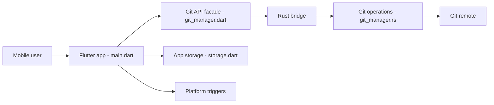

# ViscousPot/GitSync

> Client git mobile Android et iOS qui synchronise un dossier local avec un dépôt distant en arrière-plan.

## Le problème
Garder un dossier de notes ou de config synchronisé avec un dépôt git depuis un téléphone demande des manipulations manuelles et un terminal.

## Ce que ça fait vraiment
Application Flutter avec un cœur Rust (via `flutter_rust_bridge`). Authentification HTTP/S, SSH ou OAuth (GitHub, GitLab, Gitea). Sync à l'ouverture/fermeture de l'app, planifiée, par tuile, widget ou raccourci iOS. Clone, fetch, pull, commit, push, résolution de conflits, explorateur avec éditeur, issues et PR, et des fonctions IA (chat, auto-complétion, agent).

## Comment c'est branché


## Essayer
```bash
git clone https://github.com/ViscousPot/GitSync.git
cd GitSync
fvm flutter pub get
cp lib/constant/secrets.dart.template lib/constant/secrets.dart
cargo install flutter_rust_bridge_codegen --version 2.12.0
flutter_rust_bridge_codegen generate
fvm flutter run
```

## Coût et pièges
Gratuit. Compiler demande Flutter 3.35.2 (FVM), Rust et, pour iOS, Xcode 15+. Sans secrets OAuth, seuls HTTPS Basic et SSH marchent.

## Ce que ce n'est pas
Pas un client git complet de bureau. Les fonctions IA sont optionnelles (un réglage global les masque) mais le README ne dit pas quel fournisseur de modèle est appelé.

## Alternatives
Aucune nommée dans le README.

## Pour toi
Ignorer pour la veille IA : utile seulement si tu synchronises un vault ou des notes depuis un téléphone ; GPL-3.0 et mainteneur unique.

