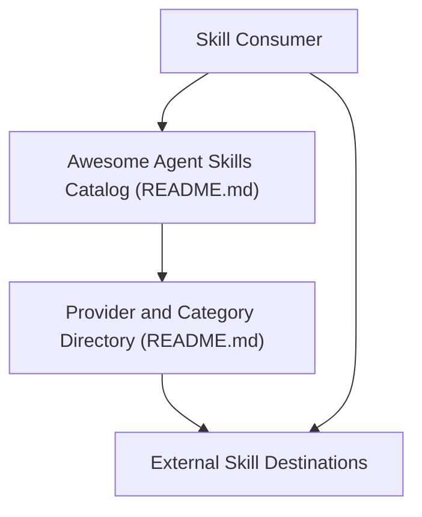

# VoltAgent/awesome-agent-skills

> Curated list of agent skills from official engineering teams and the community, compatible with several coding assistants.

## The problem
Finding good agent skills among thousands of mass-generated repositories is slow and unreliable.

## What it actually does
The README sorts skills by publisher: Anthropic (docx, pptx, xlsx, pdf, mcp-builder, skill-creator), Supabase, Stripe, HashiCorp, Cloudflare, Vercel, ClickHouse, Hugging Face and others. Each entry has a short description and an external link. The described architecture confirms that there is only the README: no executable code.

## How it is wired

## Trying it
No command documented in the part read: you open the README, pick a skill and follow its link. The README is truncated in the material provided.

## Cost and gotchas
Free. Some listed skills drive paid or keyed services (SerpApi, Crawlbase, Venice.ai). Each skill has its own license.

## What it is not
Not a repository of installable skills: it is a directory. The quality of each skill is not verified here.

## Alternatives
No alternative named in the README.

## For you
A good starting point to spot skills (Anthropic, ClickHouse, Hugging Face) to pick up for your agents; adopt as a directory.
