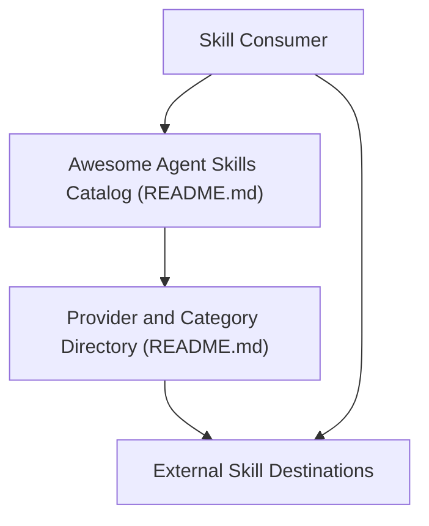

# VoltAgent/awesome-agent-skills

> Liste triée de skills d'agents officiels d'équipes techniques et de la communauté, compatibles avec plusieurs assistants de code.

## Le problème
Trouver de bons skills d'agents parmi des milliers de dépôts générés en masse est long et peu fiable.

## Ce que ça fait vraiment
Le README classe des skills par éditeur : Anthropic (docx, pptx, xlsx, pdf, mcp-builder, skill-creator), Supabase, Stripe, HashiCorp, Cloudflare, Vercel, ClickHouse, Hugging Face et d'autres. Chaque entrée a une courte description et un lien externe. L'architecture décrite confirme qu'il n'y a que le README : pas de code exécutable.

## Comment c'est branché

## Essayer
Aucune commande documentée dans la partie lue : on ouvre le README, on choisit un skill et on suit son lien. Le README est tronqué dans la matière fournie.

## Coût et pièges
Gratuit. Certains skills listés pilotent des services payants ou à clé (SerpApi, Crawlbase, Venice.ai). Chaque skill a sa propre licence.

## Ce que ce n'est pas
Pas un dépôt de skills installables : c'est un annuaire. La qualité de chaque skill n'est pas vérifiée ici.

## Alternatives
Aucune alternative nommée dans le README.

## Pour toi
Bon point de départ pour repérer des skills (Anthropic, ClickHouse, Hugging Face) à récupérer pour tes agents ; à adopter comme annuaire.

