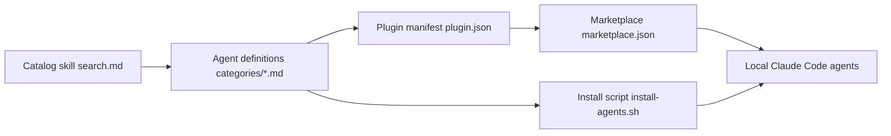

# VoltAgent/awesome-claude-code-subagents

> Catalog of more than 161 Claude Code subagents in ten categories, installable as plugins.

## The problem
Writing specialized subagents yourself (review, security, DevOps, data) takes time and diverges from one project to another.

## What it actually does
A repository of markdown files (frontmatter `name`, `description`, `tools`, `model`) spread over ten categories, including data and AI (ml-engineer, mlops-engineer, llm-architect, prompt-engineer). Installation through the Claude Code plugin marketplace, manual copy to `~/.claude/agents/`, interactive script or `subagent-catalog`. Each agent routes to opus, sonnet or haiku.

## How it is wired


## Trying it
```bash
claude plugin marketplace add VoltAgent/awesome-claude-code-subagents
claude plugin install voltagent-data-ai
./install-agents.sh
```

## Cost and gotchas
Free. The agents consume tokens from your own subscription or key. The final section of the README contains sponsored content (EveryFeed).

## What it is not
Not an orchestration framework: a catalog of prompts. The "meta" agents work better with other categories installed. Quality varies from one agent to another, nothing is measured.

## Alternatives
No alternative named in the README.

## For you
Worth watching: a useful pool of data/MLOps agents, but install them one by one after reading them.
