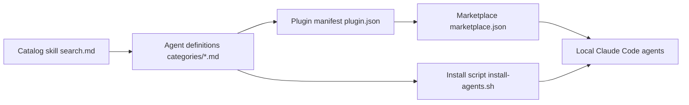

# VoltAgent/awesome-claude-code-subagents

> Catalogue de plus de 161 sous-agents Claude Code en dix catégories, installables en plugins.

## Le problème
Écrire soi-même des sous-agents spécialisés (revue, sécurité, DevOps, data) prend du temps et diverge d'un projet à l'autre.

## Ce que ça fait vraiment
Un dépôt de fichiers markdown (frontmatter `name`, `description`, `tools`, `model`) répartis en dix catégories, dont data et IA (ml-engineer, mlops-engineer, llm-architect, prompt-engineer). Installation par marketplace de plugins Claude Code, copie manuelle vers `~/.claude/agents/`, script interactif ou `subagent-catalog`. Chaque agent route vers opus, sonnet ou haiku.

## Comment c'est branché


## Essayer
```bash
claude plugin marketplace add VoltAgent/awesome-claude-code-subagents
claude plugin install voltagent-data-ai
./install-agents.sh
```

## Coût et pièges
Gratuit. Les agents consomment les jetons de ton propre abonnement ou clé. La section finale du README contient du contenu sponsorisé (EveryFeed).

## Ce que ce n'est pas
Pas un framework d'orchestration : un catalogue de prompts. Les agents « méta » fonctionnent mieux avec d'autres catégories installées. La qualité varie d'un agent à l'autre, rien n'est mesuré.

## Alternatives
Aucune alternative nommée dans le README.

## Pour toi
À surveiller : pioche utile pour les agents data/MLOps, mais installe-les un par un après relecture.

