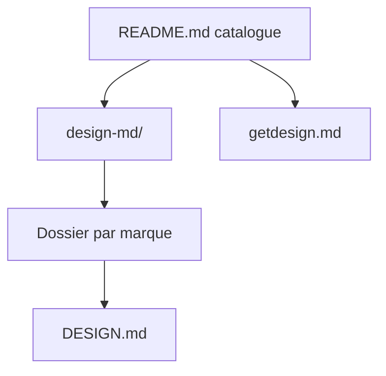

# VoltAgent/awesome-design-md

> Collection of DESIGN.md files extracted from real websites, to be provided to a code agent to generate a consistent user interface.

## The problem
A code snippet that generates a product page often uses a generic style; manually describing it (colors, typography, components) takes a significant amount of time.

## What it actually does
Content repository: a folder `design-md/<brand>/` per site (Claude, Stripe, Vercel, Linear...), containing `DESIGN.md` (theme, color palette, typography, components, layout, shadows, rules, responsive design, prompt guide), `preview.html` and `preview-dark.html`. An index hosted on getdesign.md is used for browsing and downloading.

## How it is wired

## Trying it
According to the README: copy the `DESIGN.md` file from one website to the root of the project, and then instruct the agent to use it.

## Cost and gotchas
Free. The files are analyses of public websites provided "as is": trademark and loyalty are not guaranteed. The README also promotes private requests and product placement.

## What it is not
Not a tool or a generator: only text. Not an official design system for the brands mentioned.

## Alternatives
No alternative is specified in the README.

## For you
Things to watch out for: Useful for quickly adding a code agent to a prototype or demo dashboard, but not for core data/AI functionality.
