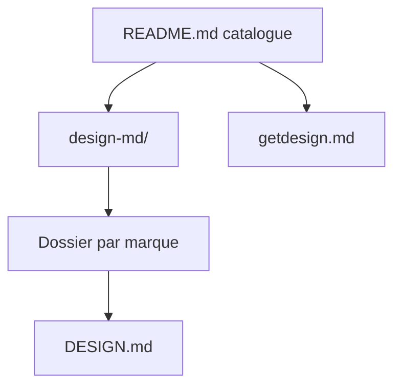

# VoltAgent/awesome-design-md

> Collection de fichiers DESIGN.md extraits de sites réels, à donner à un agent de code pour produire une UI cohérente.

## Le problème
Un agent de code qui génère une page produit souvent un style générique ; le décrire à la main (couleurs, typo, composants) prend du temps.

## Ce que ça fait vraiment
Dépôt de contenu : un dossier `design-md/<marque>/` par site (Claude, Stripe, Vercel, Linear...), avec `DESIGN.md` (thème, palette, typographie, composants, mise en page, ombres, règles, responsive, guide de prompts), `preview.html` et `preview-dark.html`. Un index hébergé sur getdesign.md sert à parcourir et télécharger.

## Comment c'est branché

## Essayer
Selon le README : copier le `DESIGN.md` d'un site à la racine du projet, puis demander à l'agent de l'utiliser.

## Coût et pièges
Gratuit. Les fichiers sont des analyses de sites publics fournies « telles quelles » : droits de marque et fidélité non garantis. Le README fait aussi la promotion de demandes privées et de placement de produit.

## Ce que ce n'est pas
Pas un outil ni un générateur : seulement du texte. Pas un design system officiel des marques citées.

## Alternatives
Aucune alternative nommée dans le README.

## Pour toi
À surveiller : utile pour habiller rapidement un prototype ou un dashboard de démo avec un agent de code, mais hors cœur data/IA.

