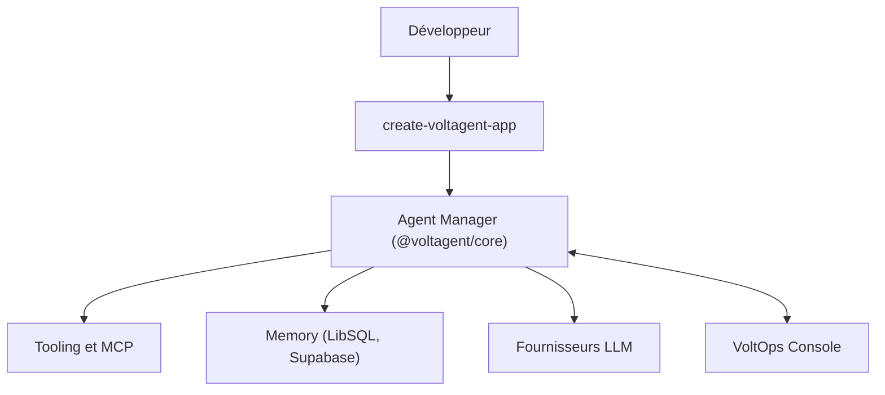

# VoltAgent/voltagent

> TypeScript framework to build AI agents with memory, tools, workflows, plus an observability console.

## The problem
Assembling agents, memory, MCP tools and execution tracking requires a lot of glue code.

## What it actually does
A `@voltagent/core` kernel defines agents, Zod-typed tools, durable memory, RAG, guardrails, voice, evaluations and resumable workflows (suspend/resume). Supervisors and sub-agents, provider switching through configuration, a documentation MCP server. The VoltOps console (cloud or self-hosted) adds traces, deployment and prompts.

## How it is wired


## Trying it
```bash
npm create voltagent-app@latest
npm run dev
```
The server starts on http://localhost:3141.

## Cost and gotchas
The model provider's API key is at your expense. The VoltOps console is a cloud service (self-hosted version mentioned). An example workflow is provided.

## What it is not
Not a model nor a ready-to-use agent: a TypeScript code framework. The console part is a product separate from the free framework.

## Alternatives
None named in the README.

## For you
Worth watching: solid if your team writes agents in TypeScript, less relevant if you work mostly in Python.
