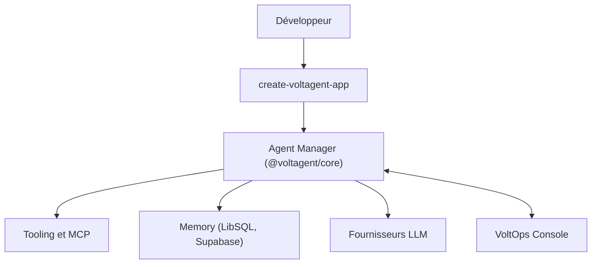

# VoltAgent/voltagent

> Framework TypeScript pour construire des agents IA avec mémoire, outils, workflows, plus une console d'observabilité.

## Le problème
Assembler agents, mémoire, outils MCP et suivi d'exécution demande beaucoup de code de liaison.

## Ce que ça fait vraiment
Un noyau `@voltagent/core` définit agents, outils typés Zod, mémoire durable, RAG, garde-fous, voix, évaluations et workflows reprenables (suspend/resume). Superviseurs et sous-agents, changement de fournisseur par configuration, serveur MCP de documentation. La console VoltOps (cloud ou auto-hébergée) ajoute traces, déploiement et prompts.

## Comment c'est branché


## Essayer
```bash
npm create voltagent-app@latest
npm run dev
```
Le serveur démarre sur http://localhost:3141.

## Coût et pièges
Clé d'API du fournisseur de modèles à ta charge. La console VoltOps est un service cloud (version auto-hébergée mentionnée). Un workflow d'exemple est fourni.

## Ce que ce n'est pas
Pas un modèle ni un agent prêt à l'emploi : un framework de code TypeScript. La partie console est un produit distinct du framework libre.

## Alternatives
Aucune nommée dans le README.

## Pour toi
Surveiller : solide si ton équipe écrit des agents en TypeScript, moins pertinent si tu travailles surtout en Python.

