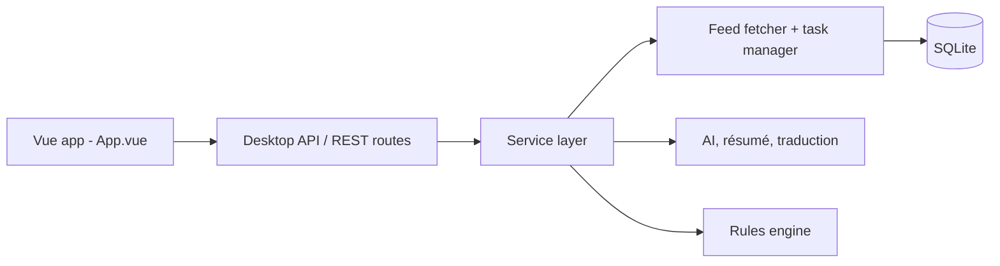

# WCY-dt/MrRSS

> Cross-platform RSS reader with translation, AI summaries and automation rules, as a desktop app or server.

## The problem
Following many feeds (RSS, newsletters, scripts) without a tool to filter, summarize and export to your notes.

## What it actually does
Wails v3 application (Go plus Vue interface) that fetches RSS/Atom feeds, e-mails, XPath and scripts, stores them in SQLite and displays them. A rules engine applies filters and actions. Summarization and translation go through an AI provider of your choice (OpenAI, Anthropic, Gemini, DeepSeek, Ollama according to the code). Integrations: FreshRSS, RSSHub, Notion, Zotero, SiYuan. Headless server mode via the `server` build tag, with a local REST API.

## How it is wired


## Trying it
```bash
docker run -p 1234:1234 mrrss-server:latest
docker run -d -p 1234:1234 ghcr.io/devxdojo/mrrss:latest-amd64
go build -tags server -o mrrss-server .
```
Or download the installer from the Releases page.

## Cost and gotchas
AI features require an API key from a provider, billed by that provider (except for a local model). Building from source: Go, Node, Wails v3 in beta, GTK dependencies on Linux.

## What it is not
It is not a hosted service. GPL-3.0 license: redistributed modifications must stay under the same license.

## Alternatives
FreshRSS and RSSHub are cited as integrations, not as substitutes.

## For you
Keep an eye on it: useful for automated monitoring with AI summaries, but Wails v3 is in beta and the GPL may get in the way of embedded use.
