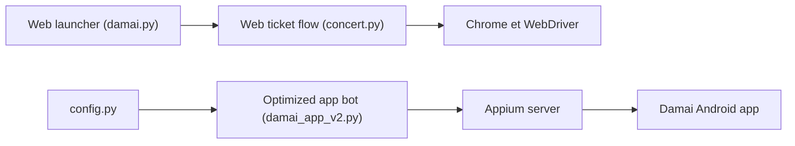

# WECENG/ticket-purchase

> Automation of Damai ticket purchases via Selenium (web) and Appium (Android).

## The problem
Concert tickets sell out in seconds; clicking by hand is too slow.

## What it actually does
Two Python scripts: Web (Selenium, `damai.py`, login and cookies, city choice, price, attendees, submission) and mobile (Appium + UiAutomator2, `damai_app_v2.py`). JSON configuration, automatic retries. The mobile one is presented as the recommended option.

## How it is wired


## Trying it
```bash
poetry install
appium --port 4723
cd damai_appium
python damai_app_v2.py
```

## Cost and gotchas
Free, but requires Appium, the Android SDK, Node 20.19+ and a device. Personal paths hard-coded in the README. No license; "study and research" use only. README in Chinese.

## What it is not
Not a guaranteed tool: risk of account blocking, and possible violation of the ticketing site's terms.

## Alternatives
None named in the README.

## For you
Ignore: no license, dubious resale use and outside the data/AI scope.
