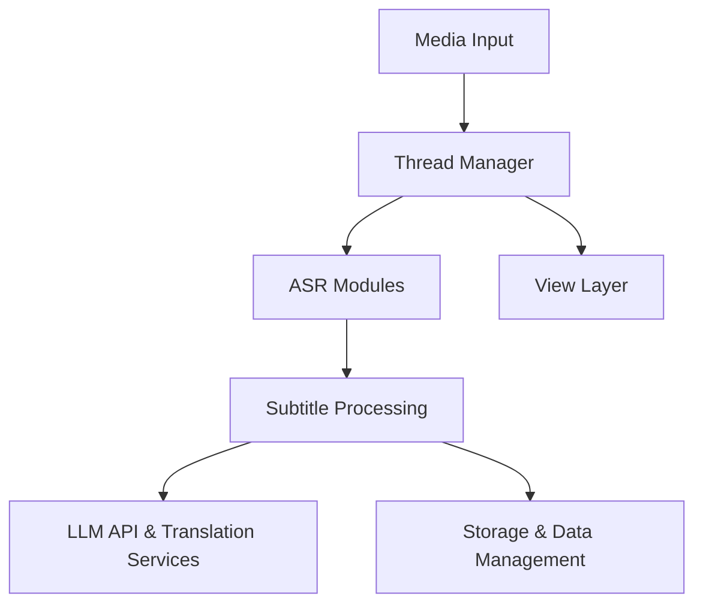

# WEIFENG2333/VideoCaptioner

> Complete video subtitling pipeline (CLI and GUI): transcription, LLM correction, translation, burn-in.

## The problem
Getting clean, translated subtitles means chaining by hand an ASR, a segmentation fix and a translation.

## What it actually does
Transcription goes through faster-whisper, whisper-cpp, whisper-api or the free engines bijian and jianying.
An LLM fixes the sentence segmentation, then translation is done via the LLM, Bing or Google.
It does dubbing, burns in subtitles (ffmpeg) and downloads from YouTube or Bilibili.
It provides a `process` command that chains everything, and a Claude Code skill.

## How it is wired


## Trying it
```bash
pip install videocaptioner
videocaptioner transcribe video.mp4 --asr bijian
videocaptioner subtitle input.srt --translator bing --target-language en
videocaptioner process video.mp4 --target-language ja
videocaptioner config set llm.api_key <your-key>
```

## Cost and gotchas
Basic features are free, but the free ASR engines (bijian, jianying) send the audio to third-party services. The LLM key is at your expense. The code is under GPL-3.0.

## What it is not
It is not an ASR model: it orchestrates existing models. The documentation is mostly in Chinese.

## Alternatives
The README names no alternative repository.

## For you
Watch: a scriptable CLI, useful for preparing audio or video corpora, but prefer faster-whisper locally for sensitive data.
