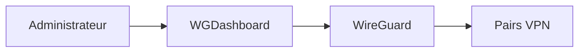

# WGDashboard/WGDashboard

> Web dashboard for managing a WireGuard VPN server.

## The problem
Administering WireGuard from the command line, peer by peer, is tedious.

## What it actually does
Not documented in the text read: the README contains only warnings, a trial program and links (help, support, shop). Nothing on installation or features. The "WireGuard dashboard" purpose follows from the name and the trial program's text.

## How it is wired

## Trying it
No command documented in the README read.

## Cost and gotchas
Free. README warning: versions v4.2.x and later exposed to the Internet must be upgraded to the latest release (v4.3.2 cited). The trial program offers 24 h or 1 GB of VPN on a server in Toronto.

## What it is not
Not a VPN in itself: it drives WireGuard. Features and architecture to be checked outside the README, which is too thin to decide.

## Alternatives
No alternative named in the README.

## For you
Worth watching: interesting if you host a VPN, but the README is too poor to judge, and a recent security fix must be checked before exposing it.
