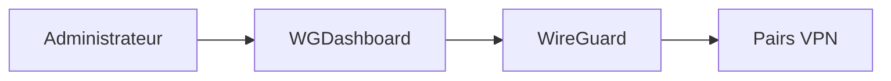

# WGDashboard/WGDashboard

> Tableau de bord web pour gérer un serveur VPN WireGuard.

## Le problème
Administrer WireGuard en ligne de commande, pair par pair, est lourd.

## Ce que ça fait vraiment
Non documenté dans le texte lu : le README ne contient que des avertissements, un programme de test et des liens (aide, soutien, boutique). Rien sur l'installation ni les fonctions. Le but « tableau de bord WireGuard » découle du nom et du texte du programme de test.

## Comment c'est branché

## Essayer
Aucune commande documentée dans le README lu.

## Coût et pièges
Gratuit. Avertissement du README : les versions v4.2.x et suivantes exposées sur Internet doivent passer à la dernière release (v4.3.2 cité). Le programme de test offre 24 h ou 1 Go de VPN sur un serveur à Toronto.

## Ce que ce n'est pas
Pas un VPN en soi : il pilote WireGuard. Fonctions et architecture à vérifier hors du README, trop mince pour trancher.

## Alternatives
Aucune alternative nommée dans le README.

## Pour toi
À surveiller : intéressant si tu héberges un VPN, mais README trop pauvre pour juger, et un correctif de sécurité récent à vérifier avant exposition.

