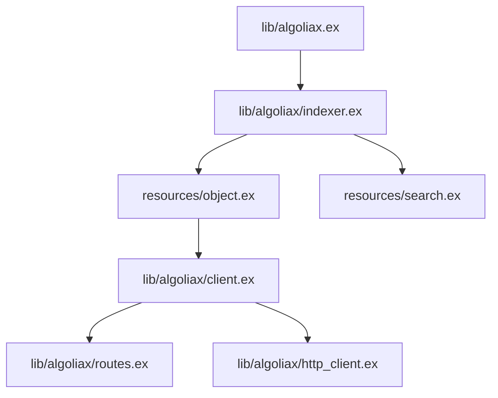

# WTTJ/algoliax

> Elixir library for indexing Ecto structs or schemas in Algolia and searching them.

## The problem
Wiring an Elixir application to Algolia means handling indexes, objects and reindexing by hand.

## What it actually does
A module declares `use Algoliax.Indexer` with its index name and settings. It gets functions to save, read and delete objects, search and search by facet, plus batch reindexing with Ecto (atomic if wanted) and replica indexes. No HTTP client is provided: the application configures one, with mandatory TLS verification.

## How it is wired


## Trying it
```bash
mix deps.get
```
```elixir
{:algoliax, "~> 0.11.0"}
```

## Cost and gotchas
An Algolia account and API keys (`ALGOLIA_API_KEY`, `ALGOLIA_APPLICATION_ID`); the plan is billed by usage. You have to write or copy the HTTP adapter, with no automatic retries or redirects.

## What it is not
Not a search engine: it depends on the Algolia service.

## Alternatives
No alternative named in the README.

## For you
Ignore: only useful if you have an Elixir application on Algolia, far from data and AI uses.
