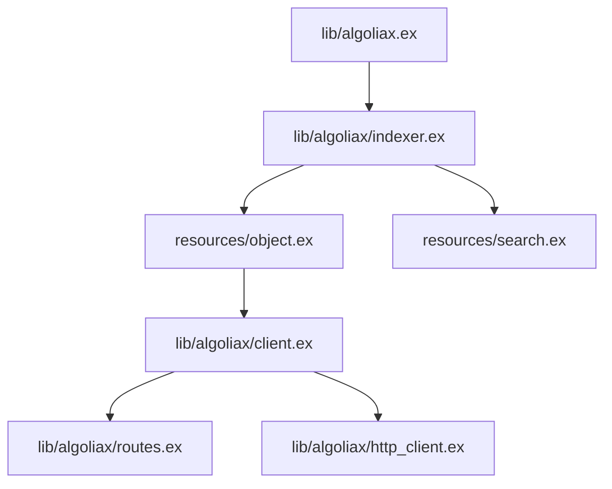

# WTTJ/algoliax

> Bibliothèque Elixir pour indexer des structures ou schémas Ecto dans Algolia et les rechercher.

## Le problème
Brancher une application Elixir sur Algolia demande de gérer index, objets et réindexation à la main.

## Ce que ça fait vraiment
Un module déclare `use Algoliax.Indexer` avec son nom d'index et ses réglages. Il obtient des fonctions pour sauvegarder, lire et supprimer des objets, chercher et chercher par facette, plus la réindexation par lots avec Ecto (atomique possible) et les index répliqués. Aucun client HTTP n'est fourni : l'application en configure un, avec vérification TLS obligatoire.

## Comment c'est branché


## Essayer
```bash
mix deps.get
```
```elixir
{:algoliax, "~> 0.11.0"}
```

## Coût et pièges
Compte Algolia et clés d'API (`ALGOLIA_API_KEY`, `ALGOLIA_APPLICATION_ID`) ; l'offre est facturée selon l'usage. Il faut écrire ou copier l'adaptateur HTTP, sans nouvelle tentative ni redirection automatiques.

## Ce que ce n'est pas
Pas un moteur de recherche : il dépend du service Algolia.

## Alternatives
Aucune alternative nommée dans le README.

## Pour toi
À ignorer : utile seulement si tu as une application Elixir sur Algolia, loin des usages data et IA.

