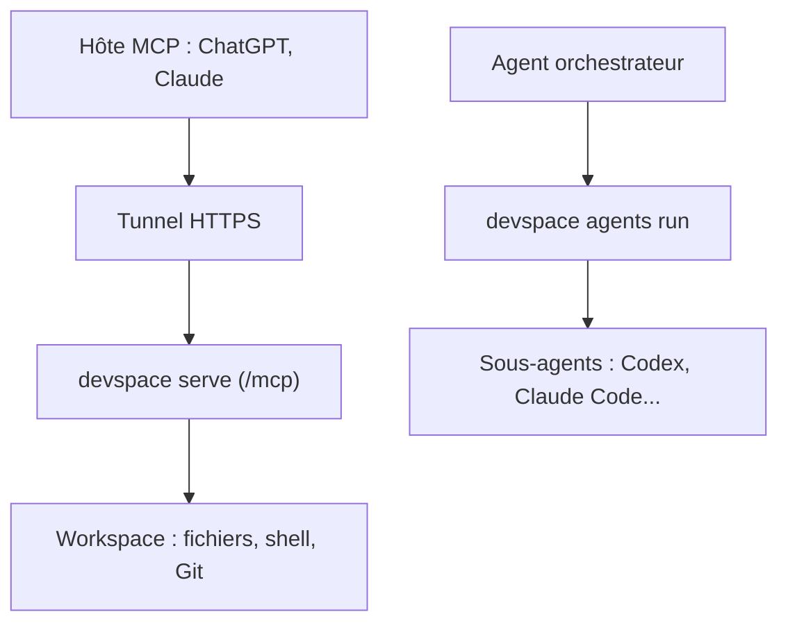

# Waishnav/devspace

> Local layer that connects ChatGPT or Claude to your repositories and makes coding agents collaborate.

## The problem
An online assistant cannot access your machine, and your coding agents do not hand work off to each other.

## What it actually does
A local MCP server, exposed through a tunnel that you own, lets a host (ChatGPT, Claude) read and edit files, run tests and commands, then display a review card of the diff. A `devspace agents` CLI launches Codex, Claude Code, OpenCode, Pi, Cursor, Copilot or Grok Build as sub-agents, with profiles and Git worktrees. There is no DevSpace service: everything runs with your credentials.

## How it is wired
Simplified diagram based on the sheet, no diagram provided.


## Trying it
```bash
curl -fsSL https://devspace.run/install | sh
devspace init --yes
devspace agents run codex "Review the staged diff for correctness"
devspace serve
```

## Cost and gotchas
Free, but you pay for your agent subscriptions. A tunnel (Cloudflare, ngrok, Tailscale...) is required for a remote host. The connected host runs shell with your rights: treat it as a trusted collaborator.

## What it is not
Not yet another agent: DevSpace has no hidden loop, your agent remains the orchestrator. Dynamic workflows are experimental.

## Alternatives
No alternative named in the README.

## For you
Watch: the idea of delegating between agents is useful, but remote shell access and a single author call for caution.
