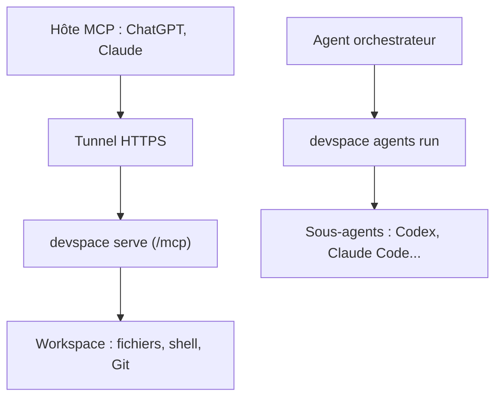

# Waishnav/devspace

> Couche locale qui relie ChatGPT ou Claude à tes dépôts et fait collaborer des agents de code.

## Le problème
Un assistant en ligne n'accède pas à ta machine, et tes agents de code ne se passent pas le travail entre eux.

## Ce que ça fait vraiment
Un serveur MCP local, exposé par un tunnel que tu possèdes, laisse un hôte (ChatGPT, Claude) lire et éditer des fichiers, lancer tests et commandes, puis afficher une carte de revue du diff. Une CLI `devspace agents` lance Codex, Claude Code, OpenCode, Pi, Cursor, Copilot ou Grok Build comme sous-agents, avec profils et worktrees Git. Aucun service DevSpace : tout tourne avec tes identifiants.

## Comment c'est branché
Schéma simplifié d'après la fiche, sans diagramme fourni.


## Essayer
```bash
curl -fsSL https://devspace.run/install | sh
devspace init --yes
devspace agents run codex "Review the staged diff for correctness"
devspace serve
```

## Coût et pièges
Gratuit, mais tu paies tes abonnements d'agents. Un tunnel (Cloudflare, ngrok, Tailscale...) est requis pour un hôte distant. L'hôte connecté exécute du shell avec tes droits : à traiter comme un collaborateur de confiance.

## Ce que ce n'est pas
Pas un agent de plus : DevSpace n'a pas de boucle cachée, ton agent reste l'orchestrateur. Les workflows dynamiques sont expérimentaux.

## Alternatives
Aucune alternative nommée dans le README.

## Pour toi
À surveiller : l'idée de déléguer entre agents est utile, mais l'accès shell à distance et un seul auteur imposent de la prudence.

